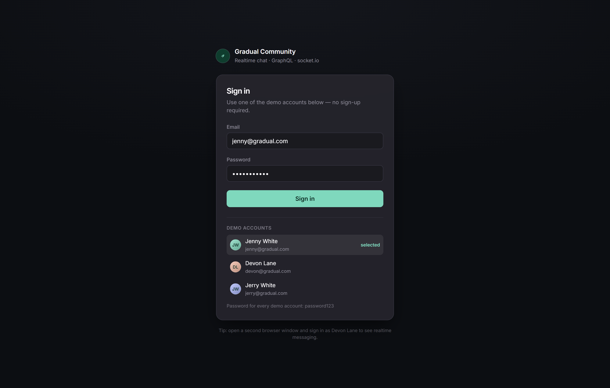
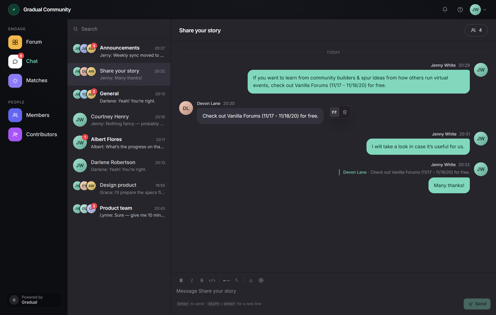
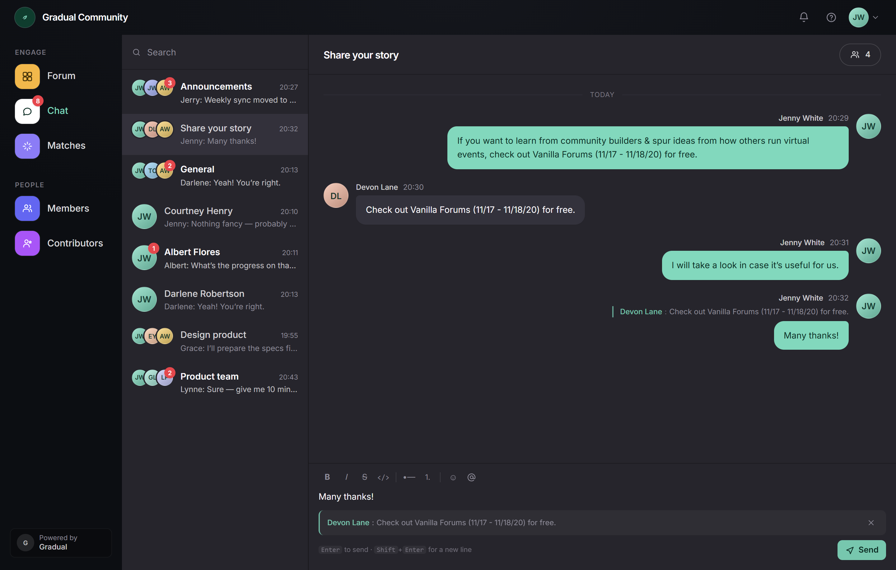
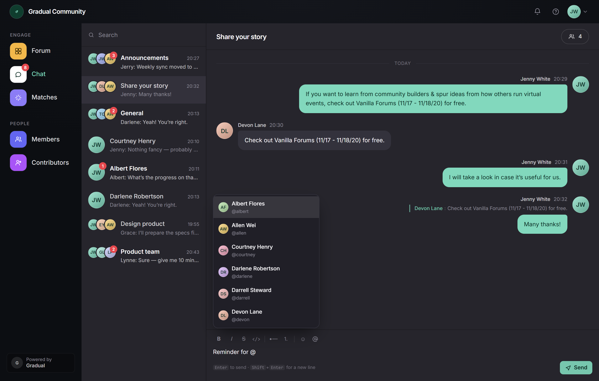
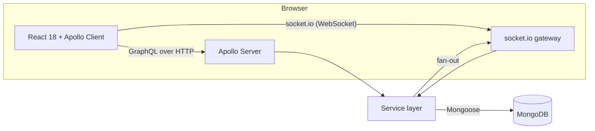

# Gradual Community — realtime chat

[English](README.md) | [简体中文](README.zh-CN.md)

A Slack-style chat application built for the **Full Stack Developer Assignment**: React + TypeScript on the
front end, Node + TypeScript + Apollo GraphQL + MongoDB on the back end, with socket.io for realtime delivery.

Everything in the brief is implemented — including all four optional items (unread counts, quote replies,
@mentions, and unit tests on both sides).


---

## Table of contents

- [Quick start](#quick-start)
- [Demo accounts](#demo-accounts)
- [What is implemented](#what-is-implemented)
- [Screenshots](#screenshots)
- [Architecture](#architecture)
- [Data model](#data-model)
- [GraphQL API](#graphql-api)
- [Realtime protocol](#realtime-protocol)
- [Project structure](#project-structure)
- [Testing](#testing)
- [Configuration](#configuration)
- [Design notes](#design-notes)
- [Trade-offs and what is next](#trade-offs-and-what-is-next)

---

## Quick start

Two supported paths — both work from a fresh clone with **no configuration**.

### Option A — npm (fastest)

Requires Node.js 20 or newer.

```bash
npm install
npm run dev
```

Open <http://localhost:5173>. The demo workspace is seeded automatically; if no MongoDB is running locally the
server boots an in-memory MongoDB and prints a warning (data is then lost on restart).

### Option B — Docker (closest to production)

Requires Docker with the compose plugin.

```bash
docker compose up --build
```

Open <http://localhost:4000>. MongoDB 7 runs in its own container with a persistent volume; the Node image serves
both the API and the built front end on a single port.

### Running against a real MongoDB

```bash
docker compose up -d mongo                       # or any MongoDB 6/7 instance
MONGODB_URI=mongodb://127.0.0.1:27017/gradual_chat npm run dev
```

`npm run seed -- --force` resets the demo data at any time.

---

## Demo accounts



Every seeded account uses the password **`password123`**. The sign-in screen lists them, so you can click one
instead of typing.

| Person | Email | Best for |
| --- | --- | --- |
| Jenny White | `jenny@gradual.com` | The default account used in the design shots |
| Devon Lane | `devon@gradual.com` | Second window — send each other messages to see realtime |
| Jerry White | `jerry@gradual.com` | Author of the unread announcements |

> Tip: open two browser windows, sign in as Jenny in one and Devon in the other. Both are members of
> *Share your story* and *Announcements*, so unread badges, typing indicators and quote replies are visible
> immediately.

---

## What is implemented

| Assignment requirement | Status | Where to look |
| --- | --- | --- |
| Web UI following the design | ✅ Four designed states reproduced (default, hover actions, quote reply, @mention picker) | `apps/web/src/components`, screenshots below |
| Realtime chat with socket.io | ✅ JWT-authenticated sockets, per-channel rooms, typing indicators | `apps/server/src/realtime` |
| MongoDB | ✅ Mongoose models, compound indexes, denormalised unread counters | `apps/server/src/models` |
| Node.js (TypeScript) | ✅ Node 22, strict TypeScript, Express + Apollo | `apps/server` |
| GraphQL | ✅ Schema-first API for every read and write | `apps/server/src/graphql/schema.graphql` |
| React.js (TypeScript) | ✅ React 18 + Vite + Apollo Client + Tailwind | `apps/web` |
| *(optional)* Unread count | ✅ Per-channel badges, @-mention markers, read cursors | `services/readState.ts` |
| *(optional)* Quote reply model + API | ✅ Self-referencing `replyToId`, same-channel validation, quote UI | `services/messages.ts` |
| *(optional)* Mention someone | ✅ Parsing, autocomplete, highlighting, mention counters | `services/mentions.ts` |
| *(optional)* Frontend and backend unit tests | ✅ 112 tests (56 backend, 56 frontend) | `apps/*/test` |

A few things the brief did not ask for but that make the app feel finished: message pagination, soft deletes,
edit support in the API, a message search filter, a `/healthz` endpoint, and a Docker image that serves the API
and the SPA from one origin (so there is no CORS setup at all).

---

## Screenshots

| Default conversation | Hover actions |
| --- | --- |
|  |  |

| Quote reply | @mention autocomplete |
| --- | --- |
|  |  |

The screenshots are generated from the running app:

```bash
npm run dev            # in another terminal
npm run screenshots    # uses your installed Chrome/Edge, writes docs/screenshots
```

---

## Architecture



**Why GraphQL for writes and socket.io for pushes?** GraphQL is a great fit for queries and mutations, but
subscriptions over `graphql-ws` add a second transport, a second auth path and per-operation authorisation logic.
Chat messages are a broadcast problem: one write, N recipients. Rooms in socket.io model that directly, and the
mutation response already gives the author an authoritative copy of the message. The result is one HTTP API, one
WebSocket channel, and no duplicated data flow.

**Same origin everywhere.** In development Vite proxies `/graphql` and `/socket.io` to the API. In production the
Express server serves `apps/web/dist` alongside the API. There is no cross-origin request in either mode, so
cookies, tokens and the socket handshake all behave identically.

**Read path.** `channels` returns the badge counts with every channel, so the sidebar renders from a single query.
`messages` is cursor-paginated by `_id`, which is monotonic and covered by the compound index.

**Write path (sending a message).**

1. `sendMessage` mutation → membership check → body validation → quote-target validation in the same channel.
2. `@handles` are parsed and resolved to user ids in one query.
3. The message is inserted; unread counters are incremented for every other member, mention counters only for the
   mentioned ones.
4. The author's own read cursor moves to the new message.
5. The socket gateway emits `message:new` to the channel room and per-user `channel:unread` to each member's
   personal room (a user belongs to many channels; broadcasting badges to the channel room would leak counts).
6. The client patches the Apollo cache instead of refetching, so the list, the sidebar preview and the badge all
   update without a network round trip.

---

## Data model

```
User      { id, name, username, email, passwordHash, avatarColor, title }
Channel   { id, name, slug, type: 'channel'|'dm', memberIds[], order }
Message   { id, channelId, authorId, body, replyToId?, mentionIds[], editedAt?, deletedAt? }
ReadState { channelId, userId, lastReadAt, lastReadMessageId, unreadCount, unreadMentionCount }
```

Indexes:

| Collection | Index | Purpose |
| --- | --- | --- |
| `Message` | `{ channelId: 1, _id: -1 }` | Cursor pagination (`_id` ordering is stable and monotonic) |
| `Message` | `{ channelId: 1, createdAt: -1 }` | Time-based queries if ever needed |
| `ReadState` | `{ channelId: 1, userId: 1 }` unique | One cursor per member per channel |
| `ReadState` | `{ userId: 1 }` | Sidebar fetch for one user |
| `Channel` | `{ memberIds: 1 }` | "Channels I belong to" |
| `User` | `username`, `email` unique | Login and `@handle` resolution |

**Unread counts are denormalised on purpose.** The alternative — counting messages newer than `lastReadAt` on
every sidebar render — costs one aggregation per channel. Instead `ReadState.unreadCount` is incremented inside the
send path and reset when the channel is opened. Deleting an unread message decrements the counter for members who
had not read it yet, so the badge cannot drift on the common paths.

**Quote replies are a self-reference.** `replyToId` points at another `Message`; the resolver returns a trimmed
preview (`id`, `body`, `author`, `createdAt`) so rendering a quoted message never loads the whole history.

---

## GraphQL API

The full schema lives in [`apps/server/src/graphql/schema.graphql`](apps/server/src/graphql/schema.graphql).
When the server is running, the Apollo landing page is available at <http://localhost:4000/graphql>.

```graphql
type Query {
  me: User
  users(query: String!): [User!]!          # @mention typeahead
  channels: [Channel!]!                    # includes unreadCount + lastMessage
  messages(channelId: ID!, cursor: String, limit: Int): MessagePage!
}

type Mutation {
  login(email: String!, password: String!): AuthPayload!
  sendMessage(input: SendMessageInput!): Message!
  markChannelRead(channelId: ID!, lastMessageId: ID): Channel!
  editMessage(id: ID!, body: String!): Message!
  deleteMessage(id: ID!): Message!
}
```

Example request:

```bash
TOKEN=$(curl -s http://localhost:4000/graphql \
  -H 'content-type: application/json' \
  -d '{"query":"mutation { login(email: \"jenny@gradual.com\", password: \"password123\") { token } }"}' \
  | node -pe 'JSON.parse(require("fs").readFileSync(0)).data.login.token')

curl -s http://localhost:4000/graphql \
  -H 'content-type: application/json' \
  -H "authorization: Bearer $TOKEN" \
  -d '{"query":"{ channels { name unreadCount lastMessage { body } } }"}'
```

Errors carry a stable `extensions.code` (`UNAUTHENTICATED`, `FORBIDDEN`, `BAD_USER_INPUT`, `NOT_FOUND`) so the
client can distinguish "your session expired" from "you typed an empty message".

---

## Realtime protocol

| Direction | Event | Payload |
| --- | --- | --- |
| client → server | `typing:start` / `typing:stop` | `{ channelId }` |
| server → client | `message:new` | `{ message }` |
| server → client | `message:updated` | `{ message }` |
| server → client | `message:deleted` | `{ messageId, channelId }` |
| server → client | `channel:unread` | `{ channelId, unreadCount, unreadMentionCount }` |
| server → client | `typing:start` / `typing:stop` | `{ channelId, user }` |

Authentication happens during the handshake (`socket.auth.token`); an invalid token is rejected before the
connection is established. A socket joins `user:<id>` plus one `channel:<id>` room per membership.

---

## Project structure

```
.
├─ apps/
│  ├─ server/                  Node 22 · TypeScript · Apollo · Mongoose · socket.io
│  │  ├─ src/
│  │  │  ├─ auth/              JWT signing, GraphQL context
│  │  │  ├─ db/                Mongo connection with in-memory fallback
│  │  │  ├─ graphql/           schema.graphql, resolvers, DTO mappers
│  │  │  ├─ models/            User, Channel, Message, ReadState
│  │  │  ├─ realtime/          socket.io gateway + emitter interface
│  │  │  ├─ seed/              demo data (mirrors the design)
│  │  │  └─ services/          business logic (messages, channels, mentions, read state)
│  │  └─ test/                 Vitest + in-memory MongoDB
│  └─ web/                     React 18 · Vite · Apollo Client · Tailwind
│     ├─ src/
│     │  ├─ components/        UI building blocks
│     │  ├─ graphql/           operations (fragments, queries, mutations)
│     │  ├─ lib/               Apollo client, socket client, cache helpers, formatting
│     │  └─ pages/             ChatPage
│     └─ test/                 Vitest + Testing Library
├─ scripts/                    screenshot capture, realtime smoke test, build helpers
├─ docs/                       screenshots and video script
├─ Dockerfile                  multi-stage build (single runtime image)
└─ docker-compose.yml          mongo + app
```

---

## Testing

```bash
npm test                 # both workspaces
npm run test:coverage    # with coverage
```

Current coverage: **83.6%** of backend statements/lines and **61.8%** of frontend lines
(**83.5%** of branches) — the frontend number is dominated by layout-only components that have no
behaviour of their own.

**Backend (56 tests).** Each file boots its own in-memory MongoDB, so nothing touches a real database.

- `mentions.test.ts` — parser edge cases: emails must not become mentions, handles stop at punctuation, case
  insensitivity, de-duplication.
- `cursor.test.ts` — cursor round-trip, malformed cursor rejection, page-size clamping.
- `auth.test.ts` / `context.test.ts` — hashing, token signing, tampered tokens, bearer-header parsing
  (including array headers and invalid tokens).
- `messages.test.ts` — unread increments only for others, mention counters, quote validation across channels,
  empty body rejection, membership enforcement, delete decrements the badge, pagination walking backwards,
  deleted messages disappearing from the timeline, sidebar badge aggregation.
- `readState.test.ts` — read-state backfill is idempotent, author cursor moves on send.
- `realtime.test.ts` — a real socket.io server and clients: unauthenticated sockets are rejected, messages reach
  the other channel member, unread badges are pushed to the recipient, typing events are scoped to members.
- `http.test.ts` — the Express surface end to end: health check, GraphQL over POST, unauthenticated requests,
  malformed JSON returning 400 rather than crashing.
- `resolvers.test.ts` — GraphQL layer through `executeOperation`: login failures, auth guards, unread in the
  channel list, `markChannelRead`, mentions, edit/delete permissions.

**Frontend (56 tests)** with Testing Library:

- `MessageBody` — bold/italic/strike/code, mention highlighting, lists, and a regression test proving raw HTML is
  never injected.
- `MessageItem` / `ChatHeader` — quote previews, "edited" marker, author-only delete, typing indicator.
- `ChannelList` / `SideRail` / `TopBar` — unread badges, @-markers, active state, search filtering, account menu.
- `Composer` — Enter sends, Shift+Enter keeps a newline, quote bar wiring, cancel reply, bold wrapping,
  typing callbacks.
- `LoginPage` — demo accounts prefill, account switching, token hand-off, error state.
- `cache` / `messagesCache` — regression cover for the two cache bugs found while building: socket payloads
  written without `__typename` (which blanked `lastMessage.author`) and cursor pagination replacing instead of
  prepending.
- `ErrorBoundary` — a render error degrades to a recoverable card instead of a white screen.
- `format` — helpers degrade gracefully on missing data.

**End-to-end (optional, local only).** `npm run verify:realtime` drives two headless browser sessions (Jenny and
Devon), sends a message and asserts delivery, the unread badge appearing while the recipient is elsewhere, and
the badge clearing when the channel is opened.

---

## Configuration

All values have working defaults — `.env` is optional (see `.env.example`).

| Variable | Default | Notes |
| --- | --- | --- |
| `PORT` | `4000` | API port (also serves the built SPA) |
| `MONGODB_URI` | local MongoDB, else in-memory | When set, the server fails loudly if it cannot connect |
| `JWT_SECRET` | dev value + warning | Must be overridden in production |
| `JWT_EXPIRES_IN` | `7d` | |
| `SEED_ON_START` | `true` | Seeds only when the users collection is empty |
| `LOG_LEVEL` | `info` | pino |
| `WEB_ORIGIN` | `http://localhost:5173` | socket.io CORS allow-list for a split-origin setup |

---

## Design notes

- **Palette** sampled from the Figma exports: rail `#0C0E12`, panels `#26252C`, own bubble `#82D8BD`, accent
  `#7FD8BD`, badge `#E5484D`, muted text `#8E8C99`.
- **Typography** is Inter (variable font bundled in `apps/web/public/fonts`, OFL licensed), so the layout does not
  depend on a CDN.
- **Avatars** are generated from initials and a per-user colour instead of shipping third-party photos; this keeps
  the repository free of licensed assets and works offline.
- **Deviations from the design, on purpose:** the composer has an explicit Send button and a keyboard hint; message
  streams show a day divider; the delete affordance only appears on your own messages (the mock shows it on
  someone else's message, which would be a permissions bug in a real product).
- **Markdown-lite** formatting (`**bold**`, `*italic*`, `~~strike~~`, `` `code` ``, lists) is rendered to React
  elements — never `innerHTML` — so a message cannot inject markup.

---

## Trade-offs and what is next

- **Single replica only.** Socket rooms live in process memory. Horizontal scaling would need the
  `@socket.io/redis-adapter` and a shared presence store; that is deliberately out of scope here.
- **No attachments.** The design shows an attachment icon; file upload storage is a separate concern (S3 + signed
  URLs) and was skipped.
- **Full-text search is not implemented** — the two search inputs filter the loaded list client-side.
- **Token storage** uses `localStorage` for simplicity. A production app would prefer an httpOnly refresh cookie
  plus short-lived access tokens.
- **Unread reconciliation.** Counters are maintained incrementally; a background job recomputing them from
  `lastReadAt` would be the safety net in production.
