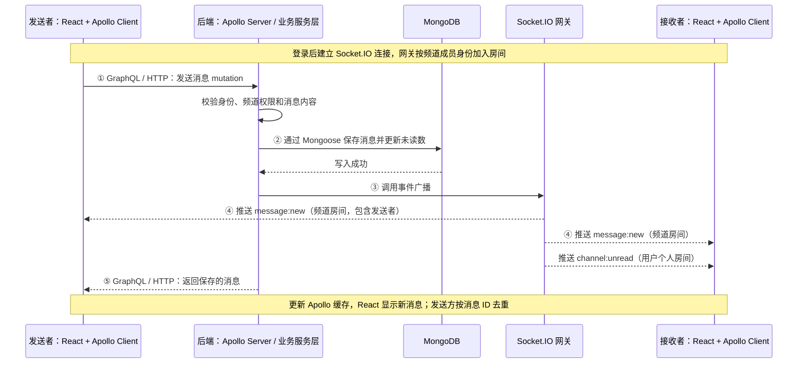

# Gradual Community — 实时聊天应用

[English](README.md) | [简体中文](README.zh-CN.md)

为 Full Stack Developer Assignment 开发的 Slack 风格聊天应用。前端使用 React + TypeScript，后端使用 Node.js + TypeScript、Apollo GraphQL 和 MongoDB，通过 Socket.IO 实现实时消息推送。

已实现题目要求的聊天界面、实时聊天，以及四项可选功能：未读计数、引用回复、@提及、前后端测试。


## 目录

- [快速启动](#快速启动)
- [演示账号](#演示账号)
- [功能清单](#功能清单)
- [界面截图](#界面截图)
- [架构与数据流](#架构与数据流)
- [数据模型](#数据模型)
- [GraphQL API](#graphql-api)
- [实时事件](#实时事件)
- [项目结构](#项目结构)
- [测试与验证](#测试与验证)
- [环境配置](#环境配置)
- [界面设计](#界面设计)
- [取舍与后续改进](#取舍与后续改进)

## 快速启动

### 使用 npm

需要 Node.js 20 或以上版本，CI 和 Docker 使用 Node.js 22。

```bash
npm install
npm run dev
```

打开 [http://localhost:5173](http://localhost:5173)。首次启动会自动初始化演示账号、频道和消息，无需手动配置环境变量。

后端默认尝试连接 `mongodb://127.0.0.1:27017/gradual_chat`。本地 MongoDB 不可用时，会启动临时 MongoDB 实例并打印提示；该实例的数据在服务停止后不保留。首次使用可能需要下载 MongoDB 二进制文件，因此需要网络访问。

### 使用 Docker Compose

需要安装 Docker 和 Compose 插件。

```bash
docker compose up --build
```

打开 [http://localhost:4000](http://localhost:4000)。Compose 启动独立的 MongoDB 7 容器并通过数据卷持久化；应用容器在同一端口提供 API 和构建后的前端。

### 连接已有 MongoDB

复制 `.env.example` 为项目根目录的 `.env`，设置连接串后启动：

```dotenv
MONGODB_URI=mongodb://127.0.0.1:27017/gradual_chat
```

```bash
npm run dev
```

也可以连接远程 MongoDB。显式设置 `MONGODB_URI` 后，如果连接失败，服务会报错退出，不会切换到临时数据库。

需要重置演示数据时运行以下命令。**该操作会清空当前连接数据库中的演示集合，请先确认连接目标。**

```bash
npm run seed -- --force
```

## 演示账号


所有种子账号的密码均为 **`password123`**。登录页提供快捷选择账号的入口。

| 姓名        | 邮箱                | 推荐用途                       |
| ----------- | ------------------- | ------------------------------ |
| Jenny White | `jenny@gradual.com` | 默认演示账号                   |
| Devon Lane  | `devon@gradual.com` | 第二个浏览器会话，验证实时聊天 |
| Jerry White | `jerry@gradual.com` | 查看公告相关演示数据           |

使用两个独立浏览器或无痕窗口，分别登录 Jenny 和 Devon。在共同频道发送消息，可验证实时送达和引用回复；让接收方切到其他频道，可观察未读消息徽标，再打开原频道验证清零。

## 功能清单

| 题目要求              | 实现情况                                        | 主要代码位置                             |
| --------------------- | ----------------------------------------------- | ---------------------------------------- |
| 按设计实现 Web UI     | 已实现会话、悬停操作、引用回复、@候选列表等状态 | `apps/web/src/components`                |
| 实时聊天              | Socket.IO、JWT 握手鉴权、频道房间               | `apps/server/src/realtime`               |
| React.js + TypeScript | React 18、Vite、Apollo Client、Tailwind         | `apps/web`                               |
| Node.js + TypeScript  | Express、Apollo Server、严格类型检查            | `apps/server`                            |
| MongoDB               | Mongoose 模型、复合索引、未读计数               | `apps/server/src/models`                 |
| GraphQL               | 使用 SDL 定义查询与变更接口                     | `apps/server/src/graphql/schema.graphql` |
| 可选：未读数          | 频道未读消息徽标、已读状态                      | `apps/server/src/services/readState.ts`  |
| 可选：引用回复        | 消息自引用、同频道校验、引用预览                | `apps/server/src/services/messages.ts`   |
| 可选：@提及           | 解析、自动补全、高亮                            | `apps/server/src/services/mentions.ts`   |
| 可选：前后端测试      | 108 个测试，前后端各 54 个                      | `apps/server/test`、`apps/web/test`      |

此外还提供消息分页、软删除、消息编辑 API、列表搜索过滤、健康检查、Docker 配置和 GitHub Actions CI。消息编辑目前通过 API 提供，前端未提供编辑入口。

## 界面截图

| 默认会话                                          | 悬停操作                                           |
| ------------------------------------------------- | -------------------------------------------------- |
|  |  |

| 引用回复                                         | @提及候选列表                              |
| ------------------------------------------------ | ------------------------------------------ |
|  |  |

截图来自运行中的应用。先启动开发服务，再在另一个终端执行：

```bash
npm run screenshots
```

脚本使用本机 Chrome 或 Edge，将截图保存到 `docs/screenshots`。未自动找到浏览器时，可设置 `CHROME_PATH` 指定可执行文件位置。

## 架构与数据流



**GraphQL 负责读写，Socket.IO 负责实时通知。** 消息写入通过 mutation 完成，服务端保存后向频道成员广播。发送方也从 mutation 响应中获得消息，前端按消息 ID 去重。

**开发和部署均使用同源访问。** 开发时由 Vite 代理 `/graphql` 和 `/socket.io`；构建后由 Express 托管前端静态资源和 API。

发送消息的主要流程：

1. 校验登录状态、频道成员权限、正文长度和引用目标所属频道。
2. 解析正文中的 `@username`，查询对应用户。
3. 保存消息，为其他频道成员增加一次未读消息数，是否被提及不影响计数。
4. 更新发送者的已读状态。
5. 向频道房间广播消息，向各用户的个人房间推送其未读计数。
6. 前端更新 Apollo 缓存，同步消息列表、频道预览和徽标；Socket.IO 重连时重新查询以恢复状态。

## 数据模型

```text
User      { id, name, username, email, passwordHash, avatarColor, title }
Channel   { id, name, slug, type: 'channel'|'dm', memberIds[], order }
Message   { id, channelId, authorId, body, replyToId?, mentionIds[], editedAt?, deletedAt? }
ReadState { channelId, userId, lastReadAt, lastReadMessageId, unreadCount }
```

| 集合        | 索引                                   | 用途                               |
| ----------- | -------------------------------------- | ---------------------------------- |
| `Message`   | `{ channelId: 1, _id: -1 }`            | 频道消息游标分页                   |
| `Message`   | `{ channelId: 1, createdAt: -1 }`      | 按频道和时间查询                   |
| `ReadState` | `{ channelId: 1, userId: 1 }` 唯一索引 | 每位成员在每个频道保留一份已读状态 |
| `ReadState` | `{ userId: 1 }`                        | 查询用户的频道未读状态             |
| `Channel`   | `{ memberIds: 1 }`                     | 查询用户加入的频道                 |
| `User`      | `username`、`email` 唯一索引           | 登录和提及用户解析                 |

未读消息数采用增量计数，减少侧栏查询时逐频道统计消息的开销。读取频道时清零，删除未读消息时相应减计数。@提及保留解析、自动补全和正文高亮，不单独维护未读计数或显示提及徽标；编辑提及不影响未读消息数。

引用回复通过 `replyToId` 自引用实现。API 返回引用消息的精简预览，无需递归加载整个历史。

## GraphQL API

完整定义见 [schema.graphql](apps/server/src/graphql/schema.graphql)。开发服务启动后，可访问 [GraphQL 入口](http://localhost:4000/graphql)。

```graphql
type Query {
  me: User
  users(query: String!): [User!]!
  channels: [Channel!]!
  messages(channelId: ID!, cursor: String, limit: Int): MessagePage!
}

type Mutation {
  login(email: String!, password: String!): AuthPayload!
  sendMessage(input: SendMessageInput!): Message!
  markChannelRead(channelId: ID!, lastMessageId: ID): Channel!
  editMessage(id: ID!, body: String!): Message!
  deleteMessage(id: ID!): Message!
}
```

先执行登录 mutation 获取 token：

```graphql
mutation {
  login(email: "jenny@gradual.com", password: "password123") {
    token
  }
}
```

后续请求携带 `Authorization: Bearer <token>` 请求头。例如查询频道：

```graphql
query {
  channels {
    id
    name
    unreadCount
    lastMessage {
      body
    }
  }
}
```

错误通过 `extensions.code` 区分，包括 `UNAUTHENTICATED`、`FORBIDDEN`、`BAD_USER_INPUT` 和 `NOT_FOUND`。

## 实时事件

| 方向            | 事件                           | 载荷                                             |
| --------------- | ------------------------------ | ------------------------------------------------ |
| 服务端 → 客户端 | `message:new`                  | `{ message }`                                    |
| 服务端 → 客户端 | `message:updated`              | `{ message }`                                    |
| 服务端 → 客户端 | `message:deleted`              | `{ messageId, channelId }`                       |
| 服务端 → 客户端 | `channel:unread`               | `{ channelId, unreadCount }`                    |

Socket.IO 在握手阶段检查 `socket.auth.token`，拒绝无效身份。连接后加入 `user:<id>` 个人房间和用户所属的 `channel:<id>` 频道房间，分别用于未读计数推送和频道消息广播。

## 项目结构

```text
apps/
├─ server/
│  ├─ src/
│  │  ├─ auth/       JWT 与 GraphQL 身份上下文
│  │  ├─ db/         MongoDB 连接及临时实例回退
│  │  ├─ graphql/    SDL、resolver 和 DTO
│  │  ├─ models/     用户、频道、消息、已读状态模型
│  │  ├─ realtime/   Socket.IO 网关与事件接口
│  │  ├─ seed/       演示数据
│  │  └─ services/   消息、频道、提及、已读状态业务逻辑
│  └─ test/          后端单元与集成测试
└─ web/
   ├─ src/
   │  ├─ components/ 界面组件
   │  ├─ graphql/    GraphQL 操作与 fragment
   │  ├─ lib/        Apollo、Socket.IO、缓存与格式化工具
   │  └─ pages/      聊天页面
   └─ test/          前端组件与缓存测试
scripts/             截图、实时冒烟测试、构建辅助脚本
docs/                演示截图与视频脚本
Dockerfile           多阶段镜像构建
docker-compose.yml   应用与 MongoDB 服务
```

## 测试与验证

```bash
npm test
npm run typecheck
npm run lint
npm run build
```

当前共 **108 个测试：后端 54 个，前端 54 个**。

后端测试使用独立的临时 MongoDB 实例，覆盖身份校验、频道权限、消息分页、引用校验、未读消息计数、提及解析、编辑删除、HTTP 与 GraphQL 接口，以及真实 Socket.IO 客户端通信。

前端使用 Vitest 和 Testing Library，覆盖登录、消息渲染、频道徽标、输入框、引用回复、格式化、错误边界和 Apollo 缓存。回归测试包括中文输入法防误发送、发送失败保留草稿并重试、可见提及候选的键盘导航和按所属频道删除缓存消息。

生成覆盖率报告：

```bash
npm run test:coverage
```

开发服务运行后，可执行双浏览器实时冒烟测试：

```bash
npm run verify:realtime
```

该脚本使用 Chrome 或 Edge 的两个独立会话，验证消息送达、未读徽标出现及打开频道后清零，并向当前开发数据库写入测试消息。

GitHub Actions 配置包含 lint、类型检查、测试、构建，以及 Docker Compose 启动与 API 检查。工作流定义见 [.github/workflows/ci.yml](.github/workflows/ci.yml)。

## 环境配置

环境变量均有开发默认值，示例见 [.env.example](.env.example)。

| 变量             | 默认值                             | 说明                                     |
| ---------------- | ---------------------------------- | ---------------------------------------- |
| `PORT`           | `4000`                             | API 与构建后前端的服务端口               |
| `MONGODB_URI`    | 本地 MongoDB，不可用时回退临时实例 | 显式设置后连接失败即退出                 |
| `JWT_SECRET`     | 开发密钥                           | 正式部署必须替换                         |
| `JWT_EXPIRES_IN` | `7d`                               | 登录 token 有效期                        |
| `SEED_ON_START`  | `true`                             | 用户集合为空时初始化演示数据             |
| `LOG_LEVEL`      | `info`                             | pino 日志等级                            |
| `WEB_ORIGIN`     | `http://localhost:5173`            | 前后端不同源时的 Socket.IO CORS 来源配置 |

## 界面设计

- 采用设计参考中的深色面板、薄荷绿色消息气泡及红色未读徽标。
- Inter 可变字体随项目提供，避免依赖外部字体 CDN。
- 头像使用姓名缩写和用户配色，便于离线运行。
- 在设计基础上增加发送按钮、键盘提示和日期分隔线；删除入口仅对消息作者显示。
- 支持粗体、斜体、删除线、行内代码和列表。消息以 React 元素渲染，不注入原始 HTML。

## 取舍与后续改进

- **单实例部署。** Socket.IO 房间保存在进程内，横向扩容需要共享适配器及在线状态存储。
- **未实现附件上传。** 当前没有对象存储或文件上传流程。
- **搜索范围有限。** 搜索用于前端已加载列表的过滤，未提供服务端全文检索。
- **Token 存储。** 当前使用 `localStorage`，正式部署可改为短期访问 token 配合 httpOnly 刷新 cookie。
- **未读一致性。** 当前增量维护计数，高并发场景仍需完善事务、一致性处理和定期校准机制。
