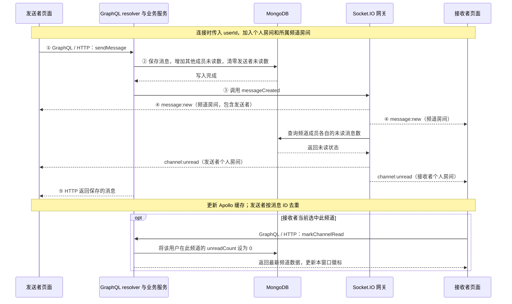
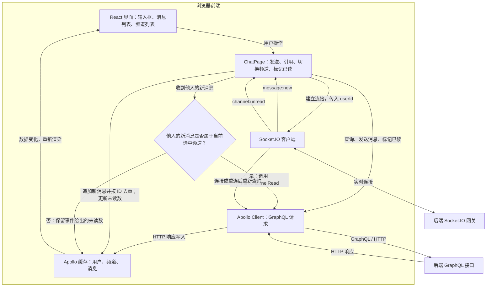
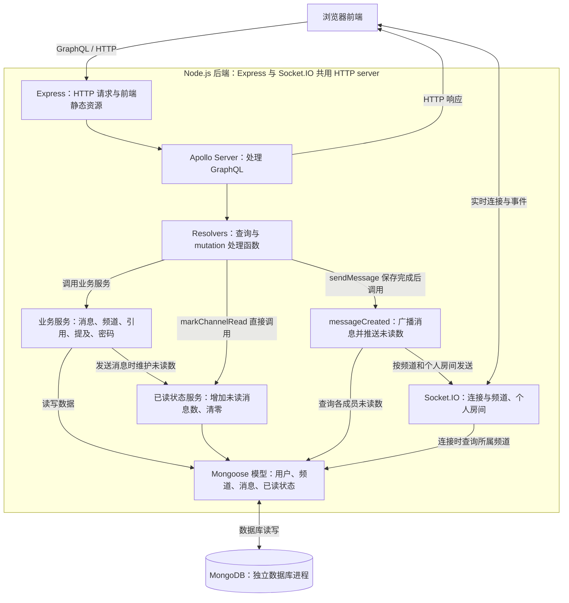
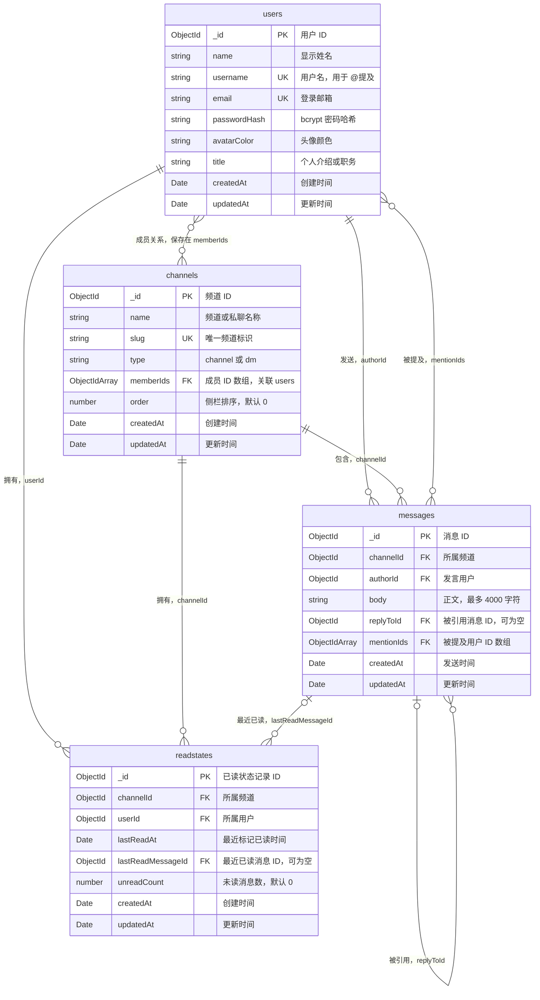

# 架构与消息流

下面的图对应当前代码中的消息流程、前后端组件和数据库结构。支持发送、引用回复、@提及和未读消息计数。保留密码登录，后续请求直接传入用户 ID；没有消息编辑、消息删除或输入状态事件。

## 1. 发送消息与标记已读

`message:new` 和 `channel:unread` 是两个独立事件；消息发给频道房间，未读数发给每个用户的个人房间。发送者也会收到这两类事件。HTTP 响应和实时事件的到达顺序不固定，因此发送者用消息 ID 去重。

“当前选中频道”指 `ChatPage` 的 `activeId`，没有额外判断窗口焦点或消息是否进入可视区域。`markChannelRead` 通过 GraphQL 返回新的频道数据，不会额外广播“已读清零”事件。

## 2. 前端数据流

未读徽标使用 `channel:unread` 给出的数值，前端不根据 `message:new` 自行累加。进入有未读消息的频道时，也会调用 `markChannelRead`。引用回复随 `sendMessage` 的 `replyToId` 提交，@提及随正文提交。

## 3. 后端组件与调用关系

Socket.IO 挂载在共享的 HTTP server 上，连接建立不经过 Apollo Server 或 resolver。Resolver 在消息保存完成后调用广播函数；广播函数使用已有房间发送事件。标记已读时，resolver 直接调用已读状态服务。

代码入口：

- 组装 HTTP server、Express 和 Socket.IO：[index.ts](../apps/server/src/index.ts)
- GraphQL 处理函数：[resolvers.ts](../apps/server/src/graphql/resolvers.ts)
- 消息保存与引用校验：[messages.ts](../apps/server/src/services/messages.ts)
- 未读计数：[readState.ts](../apps/server/src/services/readState.ts)
- 房间与事件广播：[realtime/index.ts](../apps/server/src/realtime/index.ts)
- 前端实时事件与缓存更新：[ChatPage.tsx](../apps/web/src/pages/ChatPage.tsx)

## 4. 数据库集合与关系

MongoDB 中有四个业务集合，名称由 Mongoose 模型名自动转为小写复数：

| 模型        | 实际集合名   | 一条文档表示什么                                 |
| ----------- | ------------ | ------------------------------------------------ |
| `User`      | `users`      | 一位用户及其登录、展示信息                       |
| `Channel`   | `channels`   | 一个频道或私聊会话及其成员                       |
| `Message`   | `messages`   | 一条已发送的消息，可引用另一条消息、提及多位用户 |
| `ReadState` | `readstates` | 一位用户在一个频道的未读数和已读位置             |

图中的 `ObjectIdArray` 表示 ObjectId 数组。`PK` 标记文档主键，`UK` 标记唯一索引，`FK` 仅表示应用中的 ID 引用关系，MongoDB 不会像关系型数据库一样自动检查外键，也没有额外的成员或提及关联表。

四个模型都启用了 `timestamps`，由 Mongoose 维护 `createdAt` 和 `updatedAt`；`updatedAt` 是通用时间字段，不代表提供了消息编辑功能。Mongoose 还可能保存内部版本字段 `__v`，图中省略了这个非业务字段。

### 关键字段与约束

- **用户**：`name`、`username`、`email`、`passwordHash`、`avatarColor` 为必填。用户名和邮箱保存为小写且各自唯一；`title` 默认空字符串。密码只保存哈希，不保存明文。
- **频道**：`name`、`slug` 为必填；`type` 只允许 `channel`、`dm`，默认 `channel`。`memberIds` 直接保存成员 ID。一个用户可以加入多个频道，一个频道也可以有多位用户。
- **消息**：`channelId`、`authorId`、`body` 为必填。`replyToId` 默认 `null`，普通消息不需要引用目标；引用回复仍然作为一条新消息保存，服务端校验目标属于同一频道。`mentionIds` 保存正文中解析出的用户 ID，不维护单独的未读提及数。
- **已读状态**：`channelId`、`userId` 为必填；二者组合唯一，因此每位用户在每个频道最多一条记录。`unreadCount` 最小值为 0；`lastReadMessageId` 默认 `null`，`lastReadAt` 默认 Unix 纪元时间，初始化数据可以设置初始已读位置。

例如，Devon 在两个频道各有一条 `readstates` 记录，其中一个频道的未读数可以是 3，另一个可以是 0。Jenny 在第一个频道发消息时，Devon 对应记录的 `unreadCount` 加 1；Devon 打开该频道时，这条记录的计数清零，不影响其他频道。

### 索引

除 MongoDB 默认的 `_id` 唯一索引外，当前模型声明了以下索引：

| 集合         | 索引                               | 作用                       |
| ------------ | ---------------------------------- | -------------------------- |
| `users`      | `username` 唯一；`email` 唯一      | 用户名查找和邮箱登录       |
| `channels`   | `slug` 唯一；`memberIds`           | 频道标识与查询用户所属频道 |
| `messages`   | `channelId`；`authorId`            | 按频道、发言人查找         |
| `messages`   | `{ channelId: 1, _id: -1 }`        | 按频道进行消息游标分页     |
| `messages`   | `{ channelId: 1, createdAt: -1 }`  | 按频道和时间查找           |
| `readstates` | `{ channelId: 1, userId: 1 }` 唯一 | 每个用户和频道一条已读状态 |
| `readstates` | `userId`                           | 查询用户的各频道未读状态   |

模型定义：[User.ts](../apps/server/src/models/User.ts)、[Channel.ts](../apps/server/src/models/Channel.ts)、[Message.ts](../apps/server/src/models/Message.ts)、[ReadState.ts](../apps/server/src/models/ReadState.ts)。
